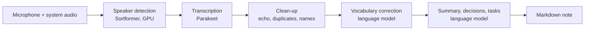

<p align="center">
  
</p>

<p align="center">
  <a href="https://github.com/feynnon/sokki/releases/latest"></a>
  
  
  <a href="LICENSE"></a>
</p>

<p align="center">
  <b>Record a call. Get a note with who said what, a summary, decisions and tasks.</b><br>
  Speech recognition, speaker detection and the summary run on your Mac. No account, no cloud, no bot joining your call.
</p>

<p align="center"><sub><b>Sokki</b> (速記) is Japanese for shorthand: literally "fast writing", the craft of taking down speech word for word as it is spoken.</sub></p>

<p align="center">
  <a href="#install">Install</a> ·
  <a href="#what-you-get">What you get</a> ·
  <a href="#how-it-works">How it works</a> ·
  <a href="#privacy">Privacy</a> ·
  <a href="#build-from-source">Build</a>
</p>

---

## Install

```bash
curl -fsSL https://raw.githubusercontent.com/feynnon/sokki/main/install.sh | bash
```

The script downloads the latest release, puts **Sokki.app** in `/Applications` and opens it. Run it again to update; your settings and meetings stay.

On first start Sokki asks for two permissions (microphone, and accessibility to type dictation into other apps) and lets you pick a speech model. For calls, macOS asks once for **System Audio Recording**, so the other side of the call is recorded too.

For summaries on your Mac, install [Ollama](https://ollama.com/download) (free). Sokki starts it and downloads the model for you under **Models → Language model**. If you prefer, pick Claude or GPT there with your own API key instead.

<sub>Requires macOS 14.2 or later on Apple Silicon (M1 or newer). Releases are not notarized by Apple: the script installs without the browser's quarantine flag, so macOS opens the app. If you download the zip by hand, macOS blocks the first start: open System Settings → Privacy & Security and click Open Anyway.</sub>

## What you get

<p align="center"></p>

| | |
|---|---|
| **Records any call** | Zoom, Teams, Google Meet, Slack, FaceTime, or the room you sit in. Microphone and system audio are recorded as two tracks, so you and the others never blur. |
| **Notices meetings** | When a call app starts using the microphone, Sokki asks whether to record. It never records on its own. |
| **Knows who spoke** | Speaker detection on the Apple GPU. On a call your microphone is you; name the others once and their voices are recognised next time. |
| **Writes the note** | Title, summary, decisions and tasks with an owner, plus the full timestamped transcript, as a Markdown file in any folder, for example your Obsidian vault. |
| **Gets names right** | Add customers, colleagues and products to the Vocabulary. Misheard versions are corrected, and only when the language model and a sound check agree. |
| **Dictation too** | Hold a shortcut, speak, and the text appears where your cursor is. That part is [Handy](https://github.com/cjpais/Handy), the app Sokki is built on. |

A 20-minute call is ready about three minutes after you hang up, on an M-series Mac.

### An example note

```markdown
# Launch plan for the spring campaign

## Summary
- Anna and Ben agree to move the landing page launch to Monday.
- The ad budget stays at 2,000 € for the first two weeks.
- Ben asks whether the customer interviews can feed the new ad copy.

## Decisions
- Launch on Monday instead of Friday.

## Tasks
- [ ] **Ben**: send the final copy to the customer by Friday
- [ ] **Robin**: set up the first two ad variants

## Transcript
**[00:00] Anna:** Can we still make Friday, or should we move the launch?
**[00:06] Ben:** I'd rather move it to Monday, the copy isn't approved yet.
```

## How it works



| Step | Default | Options |
|---|---|---|
| Speech recognition | NVIDIA Parakeet (25 European languages, fast) | Whisper, Canary, Qwen-ASR and more on the Models page |
| Speakers | NVIDIA Sortformer on the GPU, CPU fallback | Remembered voices per person |
| Summary and correction | Qwen 3.5 9B via Ollama, on your Mac | Claude, GPT or OpenRouter with your own key |

Each model is downloaded once and then runs offline. The measurements behind these choices, including what was tried and rejected, are in [KNOWN_ISSUES.md](KNOWN_ISSUES.md).

## Your data

Sokki keeps **your own voice** with its transcript on your Mac until you delete it: your dictations, and in calls only what you said into your microphone. Never other people's voices. The **Your data** page shows how many hours you have per language, and deletes them with one click. Nothing of it is uploaded.

On first start Sokki offers two things, both off until you tick them, and both can be switched off any time:

- **Help improve Sokki.** Once a day, under a random ID, Sokki sends how it is used (dictations, meeting minutes, models), problems it ran into, how much data you have per language, and your Mac's model and macOS version. Never other people's voices or words, voice prints, your name or your Mac's name.
- **Support Sokki & Open Source.** Your anonymised data may be used freely: to improve Sokki, for open-source speech models, and shared or sold. You aren't asked again and get no share.

If someone wants to buy data like yours (say, German conversations), Sokki tells you with a notification, but only if enough of your data fits. It finds that out on your Mac: it downloads the message and compares it with what you have, and nothing is sent unless you answer "I'm interested". Before anything would be sold, you'd see what and for how much, and decide then. There's no buyer yet.

The counter and the messages live on a tiny service in [`counter/`](counter/).

## Privacy

- Audio, transcripts and notes stay on your Mac. Meeting recordings are deleted after the period you choose; your own voice with its transcript stays until you delete it on the **Your data** page.
- The only network requests are model downloads, the transcript sent to a cloud provider only if you pick a cloud model for the summary, and the small counter: a few times a day Sokki downloads its current message.
- No account, no update checks. No usage reports unless you turn on **Help improve Sokki**.
- **Delete what was shared** on the Your data page removes everything the counter holds of your Mac.
- Recording people needs their consent: tell everyone on the call.

## Build from source

You need macOS on Apple Silicon, [Rust](https://rustup.rs), [Bun](https://bun.sh) and the Xcode Command Line Tools.

```bash
git clone https://github.com/feynnon/sokki.git
cd sokki
bun install
scripts/build-and-install.sh            # builds Sokki and installs it to /Applications
BRAND=handy scripts/build-and-install.sh  # the same app with Handy's look
```

[MEETINGS.md](MEETINGS.md) explains the meeting pipeline, the code layout and the test harness; [CONFIG.md](CONFIG.md) lists every setting. The meeting code lives in `crates/` (platform-independent Rust) and `src-tauri/src/meeting/`.

## Credits

Sokki is a fork of **[Handy](https://github.com/cjpais/Handy)** by CJ Pais, which does the dictation and the model management. Meeting recording comes from [Mandy](https://github.com/yuri-research-ai/Mandy), meeting detection follows [Lark](https://github.com/bkoleo/lark). Models by NVIDIA (Parakeet, Sortformer) and Alibaba (Qwen), run with [ggml](https://github.com/ggml-org/ggml) and [Ollama](https://ollama.com). Details in [THIRD_PARTY_NOTICES.md](THIRD_PARTY_NOTICES.md).

## License

[MIT](LICENSE) © 2025 CJ Pais, © 2026 Robin Dehde.
