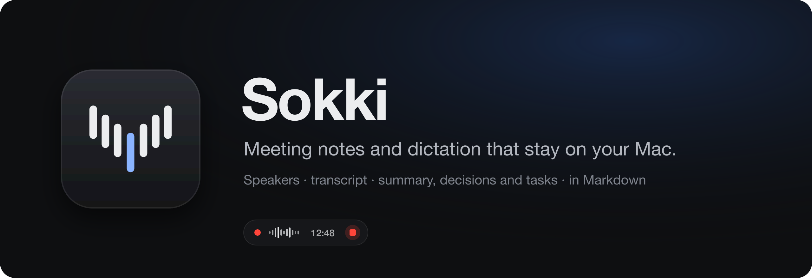
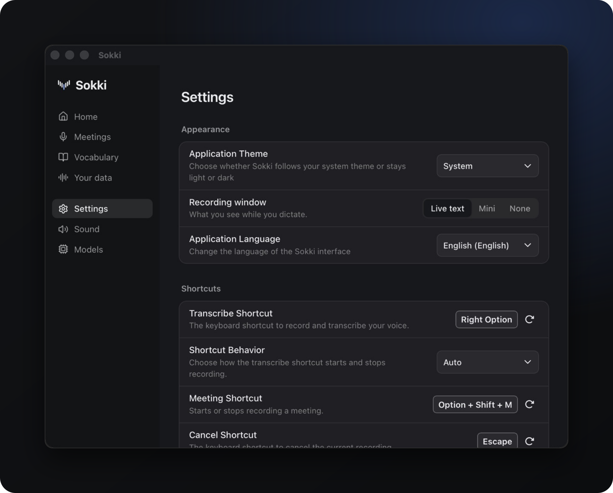

<!-- DEMO VIDEO (30–45 s). Until it is recorded, the hero image stands in.
     To add it: on github.com, edit this file and drag the .mp4 onto the editor.
     GitHub uploads it and inserts a https://github.com/user-attachments/assets/… URL.
     Put that URL on its own line here, in place of the <p> with hero.png below. -->
<p align="center">
  
</p>

<h3 align="center">Dictation and meeting notes, on your Mac.<br>Local. Free forever. Open source.</h3>

<p align="center">
  <a href="https://github.com/feynnon/sokki/releases/latest/download/Sokki-arm64.zip"></a>
</p>

<p align="center"><sub>31 MB · Apple silicon · macOS 14.2 or later · No account</sub></p>

<p align="center"><sub>Built on <a href="https://github.com/cjpais/Handy">Handy</a> by CJ Pais. <b>Sokki</b> (速記) is Japanese for shorthand. <a href="https://sokki.org">sokki.org</a></sub></p>

---

## How it differs

- **[Handy](https://github.com/cjpais/Handy)** is the dictation app Sokki is built on. Sokki adds meetings.
- **[Yogurt](https://github.com/FrigadeHQ/yogurt), [Muesli](https://github.com/Muesli-HQ/muesli) and [Meetily](https://github.com/Zackriya-Solutions/meetily)** take meeting notes locally too. Sokki remembers a voice once you name it, and keeps speaker labels and call detection free ([Pro in Meetily](https://meetily.ai/pro/)).
- **[Superwhisper](https://superwhisper.com/docs/billing/plans)** puts Parakeet, system audio and speaker separation in Pro, at $8.49 a month. In Sokki they're free. [Why](https://sokki.org/why-free/).

## Speak anywhere.

Hold a key, talk, let go. The text lands at your cursor, in any app. 25 languages.

## Asks before it records.

When Zoom, Teams, Meet, Slack or FaceTime start a call, Sokki asks once. No bot joins.

- **Two tracks.** Your microphone and the call, recorded apart, echo removed.
- **Who said what.** Speakers detected on the Apple GPU. Name a voice once.
- **The note.** Summary, decisions, tasks with an owner, full transcript. Markdown, in any folder.
- **Names right.** Add people and products to the Vocabulary.

A 20 min call is ready about 3 min after you hang up, on an M-series Mac.

<p align="center"></p>

```markdown
# Launch plan for the spring campaign

## Decisions
- Launch moves to Monday.

## Tasks
- [ ] **Ben**: final copy by Friday
- [ ] **You**: two ad variants

## Transcript
**[00:00] Anna:** Can we still make Friday?
**[00:06] Ben:** I'd rather move it to Monday.
```

## What you need

- A Mac with Apple silicon, macOS 14.2 or later.
- 0.9 GB for the speech and speaker models, downloaded once.
- For summaries on your Mac: 5.7 GB more, and 6.4 GB of memory while a summary runs. Sokki offers the model under **Models → Language model**. Or pick Claude or GPT there with your own key.

Prefer Terminal? This installs Sokki, and updates it when run again. Settings and meetings stay.

```bash
curl -fsSL https://raw.githubusercontent.com/feynnon/sokki/main/install.sh | bash
```

## How it works

| Step | Default | Options |
|---|---|---|
| Echo removal | WebRTC echo cancellation | — |
| Speakers | NVIDIA Sortformer, GPU | Remembered voices |
| Speech recognition | NVIDIA Parakeet, 25 languages | Whisper, Canary, Qwen-ASR and more |
| Summary | Qwen 3.5 9B, built in, on your Mac | Ollama; Claude, GPT or OpenRouter with your key |

Models download once, then run offline. Measurements behind these choices: [KNOWN_ISSUES.md](KNOWN_ISSUES.md).

## Stays on your Mac.

Audio, transcripts, notes and named voices stay on your Mac. Meeting audio is deleted after the period you choose. Recording people needs their consent: tell everyone on the call.

**Every connection Sokki makes:**

| What | When | To |
|---|---|---|
| Model downloads | Once per model you pick | Hugging Face, Handy's mirror (`blob.handy.computer`) |
| Update check | At start; switch off under **Check for Updates** | GitHub |
| Sokki's message | Every 6 hours and when you open Settings: downloads one message, sends nothing | Sokki's counter on Cloudflare |
| Cloud model | Only if you pick one with your own key: the transcript or dictated text | That provider |
| Phone link | Off. When on, helps a paired phone find this Mac; end-to-end encrypted | n0's public relays ([iroh](https://www.iroh.computer)) |
| Help improve Sokki | Off. When on, once a day: usage counts, problems, hours per language, Mac model and macOS version, under a random ID | Sokki's counter |
| Ask me when there's a buyer | Off. Nothing leaves until you answer a buyer message | Sokki's counter |
| Share all my recordings | Off. When on, uploads your recordings and their transcripts unchanged, for Sokki to use, share or sell | Sokki's counter |

Ollama, if you use it, runs on your Mac. No account. No usage reports unless you turn them on. Details: [sokki.org/privacy](https://sokki.org/privacy/) and [`counter/`](counter/). Check it yourself with a network monitor such as [LuLu](https://objective-see.org/products/lulu.html).

## Build from source

You need macOS on Apple silicon, [Rust](https://rustup.rs), [Bun](https://bun.sh) and the Xcode Command Line Tools.

```bash
git clone https://github.com/feynnon/sokki.git
cd sokki
bun install
scripts/build-and-install.sh            # builds Sokki and installs it to /Applications
```

[MEETINGS.md](MEETINGS.md) explains the meeting pipeline, the code layout and the test harness; [CONFIG.md](CONFIG.md) lists every setting. The meeting code lives in `crates/` (platform-independent Rust) and `src-tauri/src/meeting/`.

Contributions are welcome: [CONTRIBUTING.md](CONTRIBUTING.md).

## Credits

Sokki is a fork of **[Handy](https://github.com/cjpais/Handy)** by CJ Pais. Handy does the dictation and the model management, and Sokki would not exist without it. Meeting recording comes from [Mandy](https://github.com/yuri-research-ai/Mandy), meeting detection follows [Lark](https://github.com/bkoleo/lark). Models by NVIDIA (Parakeet, Sortformer) and Alibaba (Qwen), run with [ggml](https://github.com/ggml-org/ggml) and [llama.cpp](https://github.com/ggml-org/llama.cpp). Details in [THIRD_PARTY_NOTICES.md](THIRD_PARTY_NOTICES.md).

## License

- **Mac app and shared code** (everything outside `mobile/`): [MIT](LICENSE) © 2025 CJ Pais, © 2026 Robin Dehde.
- **Android app** (`mobile/`): [GPL-3.0](mobile/LICENSE), because its keyboard is built on [HeliBoard](https://github.com/HeliBorg/HeliBoard). The shared Rust crates it uses (`crates/`) stay MIT.
